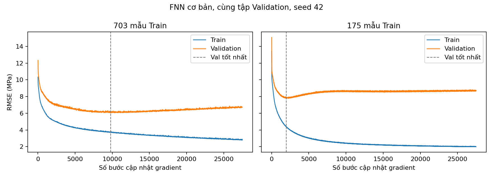

# Câu 1 — Hồi quy cường độ nén bê tông bằng FNN

## Dữ liệu và tiền xử lý

Thí nghiệm sử dụng bộ **Concrete Compressive Strength** do I-Cheng Yeh cung cấp cho UCI Machine Learning Repository. Bộ dữ liệu có 1.030 mẫu, tám đặc trưng đầu vào và một biến mục tiêu là cường độ nén, tính bằng MPa. [UCI Machine Learning Repository](https://archive.ics.uci.edu/dataset/165/concrete+compressive+strength)

Máy đám mây nhận lỗi HTTP 403 khi tải trực tiếp từ máy chủ UCI. Tệp `cau1/data/Concrete_Data.xls` được lấy từ bản lưu công khai có kèm tài liệu của bộ dữ liệu. Toàn bộ giá trị trong tệp được đối chiếu với một bản XLS lưu độc lập và khớp hoàn toàn. Tệp `concrete.csv` được xuất từ XLS, đổi tên cột và giữ nguyên giá trị số. [Bản XLS trong repo được lấy từ đây](https://raw.githubusercontent.com/zackwwhite/UCI-Concrete-Compressive-Strength/9f3cdc046703c2846a163f5b86aba323bf473378/data/Concrete_Data.xls) · [Tài liệu đi kèm](https://raw.githubusercontent.com/zackwwhite/UCI-Concrete-Compressive-Strength/9f3cdc046703c2846a163f5b86aba323bf473378/data/Concrete_Readme.txt) · [Bản XLS dùng để đối chiếu](https://raw.githubusercontent.com/alexandrenm2/Concrete-compressive-strength-prediction/bf18488cd1cae35c66df1c17c554c2ecaea5f1ae/Concrete_Data.xls)

Chương trình kiểm tra dữ liệu thiếu và dòng trùng trước khi chia tập. Dữ liệu có 0 ô thiếu và **25 dòng trùng bị loại, còn 1.005 mẫu**. Tỷ lệ chia xấp xỉ 70/15/15, với 703 mẫu Train, 151 mẫu Validation và 151 mẫu Test. Các scaler của $X$ và $y$ được fit trên Train rồi dùng để biến đổi cả ba tập.

## Hàm mất mát và gradient

### Lan truyền tiến và hàm mục tiêu

Mạng dùng tám đặc trưng đầu vào, hai tầng ẩn lần lượt 64 và 32 nơ-ron và đầu ra tuyến tính một chiều. Hai tầng ẩn dùng tanh. Trọng số được khởi tạo bằng Xavier và bias bắt đầu bằng 0. Gọi $N$ là số mẫu Train, $B$ là kích thước thực tế của mini-batch và $L$ là chỉ số tầng ra. Đặt $A^{(0)}=X$ cho ma trận đầu vào của batch. Ở tầng $\ell$, phép truyền xuôi là $Z^{(\ell)}=A^{(\ell-1)}W^{(\ell)}+b^{(\ell)}$. Với tầng ẩn, $A^{(\ell)}=\tanh Z^{(\ell)}$. Tầng ra trả về $\hat y=Z^{(L)}$.

Hàm mục tiêu mà mỗi bước Gradient Descent dùng là **nửa MSE mini-batch cộng L2**.

$$
J_B = \underbrace{\frac{1}{2B}\sum_{i=1}^B (\hat y_i-y_i)^2}_{J_{\mathrm{data}}=\frac12\operatorname{MSE}_B}
      + \frac{\lambda}{2N}\sum_{\ell=1}^{L}\lVert W^{(\ell)}\rVert_F^2.
$$

### Chứng minh gradient bằng quy tắc dây chuyền

Đạo hàm của bình phương sai số đưa ra hệ số 2, triệt tiêu hệ số $1/2$. Tầng ra tuyến tính có đạo hàm bằng 1 nên $dZ^{(L)}=(\hat y-y)/B$. Với tầng ẩn, quy tắc dây chuyền nhân gradient truyền ngược với đạo hàm của tanh, phần tử theo phần tử.

$$
dZ^{(\ell)}_{ij} =
\left(\sum_q dZ^{(\ell+1)}_{iq} W^{(\ell+1)}_{jq}\right)
\left(1-(A^{(\ell)}_{ij})^2\right).
$$

Dạng ma trận của biểu thức trên là

$$
dZ^{(\ell)}
= \left(dZ^{(\ell+1)}(W^{(\ell+1)})^\top\right)
  \odot \left(1-(A^{(\ell)})^2\right).
$$

Với mẫu $i$ và nơ-ron $j$, $Z^{(\ell)}_{ij}=\sum_k A^{(\ell-1)}_{ik}W^{(\ell)}_{kj}+b^{(\ell)}_j$. Do đó $\partial Z^{(\ell)}_{ij}/\partial W^{(\ell)}_{kj}=A^{(\ell-1)}_{ik}$ và $\partial Z^{(\ell)}_{ij}/\partial b^{(\ell)}_j=1$. Hai tham số này chỉ ảnh hưởng đến cột $j$ trong $Z^{(\ell)}$. Nhân từng đạo hàm với $dZ^{(\ell)}_{ij}$ rồi cộng theo các mẫu trong mini-batch cho gradient của phần nửa MSE.

$$
\frac{\partial J_{\mathrm{data}}}{\partial W^{(\ell)}_{kj}}
=\sum_{i=1}^B dZ^{(\ell)}_{ij}A^{(\ell-1)}_{ik},
\qquad
\frac{\partial J_{\mathrm{data}}}{\partial b^{(\ell)}_j}
=\sum_{i=1}^B dZ^{(\ell)}_{ij}.
$$

Vì $\lVert W\rVert_F^2=\sum_{k,j}W_{kj}^2$, đạo hàm phần L2 theo $W_{kj}$ là $\lambda W_{kj}/N$. Hàm phạt chỉ phụ thuộc vào trọng số nên đạo hàm phần L2 theo bias bằng 0. Cộng hai phần gradient cho kết quả

$$
dW^{(\ell)} = (A^{(\ell-1)})^\top dZ^{(\ell)} + \frac{\lambda}{N}W^{(\ell)},
\qquad
db^{(\ell)} = \sum_{i=1}^{B} dZ^{(\ell)}_{i,:}.
$$

Hệ số $1/B$ đã có trong gradient tầng ra. Với learning rate $\eta$, bước cập nhật $W \gets W-\eta\,dW$ tương đương với $W \gets (1-\eta\lambda/N)W-\eta\,\partial J_{\mathrm{data}}/\partial W$. Khi bật L2 với các siêu tham số trong thí nghiệm, hệ số $1-\eta\lambda/N$ nằm giữa 0 và 1 nên làm co trọng số ở mỗi bước cập nhật.

### Mã giả huấn luyện bằng Gradient Descent trên mini-batch

```text
Khởi tạo W bằng Xavier và b bằng 0
Đặt λ = 0 nếu tắt L2
Khởi tạo loss tốt nhất và mốc patience bằng +∞, bộ đếm bằng 0
Với mỗi epoch trong ngân sách huấn luyện:
    Xáo trộn chỉ mục Train và chia thành các mini-batch
    Với mỗi mini-batch:
        Lan truyền tiến để lấy dự đoán và lưu các kích hoạt
        Tính dZ ở tầng ra từ sai số dự đoán
        Lan truyền ngược để tính dW và db cho mọi tầng
        Cập nhật đồng thời W ← W − η·dW và b ← b − η·db
    Ghi nửa MSE trên toàn bộ Train và Validation
    Nếu bật Early Stopping:
        Nếu Validation Loss đạt cực tiểu mới, sao chép W, b và ghi epoch
        Nếu mức giảm so với mốc patience lớn hơn min_delta:
            Đặt mốc bằng Validation Loss hiện tại và đặt bộ đếm về 0
        Nếu không, tăng bộ đếm thêm 1
        Nếu bộ đếm đạt patience, dừng vòng lặp epoch
Nếu bật Early Stopping, khôi phục W và b tại cực tiểu Validation Loss
Trả về tham số và lịch sử loss
```

## Thiết kế thí nghiệm

Trong mỗi seed, bốn cấu hình dùng cùng tập chia, cùng tham số khởi tạo và cùng thứ tự xáo trộn mini-batch. Kiến trúc `(64, 32)`, learning rate `0.035` và ngân sách 2.500 epoch được ấn định trước. FNN cơ bản và FNN + L2 chạy đủ ngân sách này.

Early Stopping giữ hai mốc riêng. Bộ đếm `patience` về 0 khi Validation Loss giảm **hơn** `min_delta=1e-5` so với mốc của lần đặt lại gần nhất. Lần đặt lại đó cũng cập nhật mốc tham chiếu. Nếu có 150 epoch liên tiếp chưa đạt mức giảm này, huấn luyện dừng. Song song, chương trình lưu bản sao sâu của trọng số và bias mỗi khi Validation Loss đạt cực tiểu mới, kể cả khi mức giảm chưa đủ để đặt lại bộ đếm. Mô hình cuối khôi phục bản sao ở cực tiểu trong các epoch đã chạy.

Chương trình chọn một $\lambda$ từ $\{0.1, 1, 5, 20\}$ theo Validation Loss tại epoch cuối của các lượt chạy L2 cố định, rồi dùng chung giá trị đó cho hai cấu hình có L2. Đường loss Train và Validation dùng nửa MSE thuần trên $y$ chuẩn hóa. Bảng metric dùng dự đoán đã đổi về thang gốc bằng `inverse_transform`. MSE được tính theo MPa², còn RMSE và MAE theo MPa.

Các số Validation được báo cáo để mô tả quá trình chọn $\lambda$ và checkpoint. Vì cùng tập này được dùng để chọn mô hình, các số đó có thể lạc quan. Các nhận xét về khả năng tổng quát hóa dựa trên Test, được giữ riêng trong mỗi seed. Mỗi mô hình cuối dự đoán Test một lần trong mỗi seed.

## Kết quả

Gradient check dùng sai phân trung tâm trên mạng nhỏ và năm mẫu Train, với L2 bật. Sai số tương đối đo được là `2.643e-11`, dưới ngưỡng `1e-7`.

Bảng ghi trung bình ± độ lệch chuẩn mẫu qua các seed 42, 7, 13, 21 và 73.

| Cấu hình | Tập | MSE (MPa²) | RMSE (MPa) | MAE (MPa) |
| --- | --- | ---: | ---: | ---: |
| FNN | Train | 7.4979 ± 0.7105 | 2.7357 ± 0.1317 | 1.9570 ± 0.0961 |
| FNN | Validation | 28.8066 ± 9.2305 | 5.3204 ± 0.7903 | 3.5852 ± 0.2871 |
| FNN | Test | 27.4767 ± 4.0049 | 5.2304 ± 0.3860 | 3.6376 ± 0.2337 |
| FNN + ES | Train | 15.1358 ± 3.1776 | 3.8727 ± 0.4150 | 2.9233 ± 0.3331 |
| FNN + ES | Validation | 28.3714 ± 5.9036 | 5.3037 ± 0.5508 | 3.7854 ± 0.4170 |
| FNN + ES | Test | 29.6540 ± 4.7233 | 5.4318 ± 0.4326 | 3.9441 ± 0.3816 |
| FNN + L2 | Train | 10.8455 ± 3.3804 | 3.2620 ± 0.5059 | 2.3957 ± 0.4219 |
| FNN + L2 | Validation | 27.6296 ± 7.6443 | 5.2216 ± 0.6754 | 3.6524 ± 0.3451 |
| FNN + L2 | Test | 30.5944 ± 4.3169 | 5.5199 ± 0.3958 | 3.8124 ± 0.3126 |
| FNN + ES + L2 | Train | 16.8300 ± 1.7468 | 4.0981 ± 0.2104 | 3.0966 ± 0.1721 |
| FNN + ES + L2 | Validation | 29.1340 ± 6.5091 | 5.3719 ± 0.5878 | 3.8791 ± 0.3757 |
| FNN + ES + L2 | Test | 31.6401 ± 5.0066 | 5.6101 ± 0.4571 | 4.0554 ± 0.3569 |

Ở seed 42, Validation Loss chọn $\lambda=1$. FNN cơ bản đạt Validation Loss thấp nhất tại epoch 888 và tiếp tục huấn luyện đến epoch 2.500. Khi áp dụng Early Stopping, mô hình dừng ở epoch 1.038 và khôi phục epoch 888. Khoảng cách Validation–Train giảm từ 0.07344 xuống 0.04358 và Test RMSE giảm từ 5.3194 xuống 5.2817 MPa. Test MAE tăng từ 3.5506 lên 3.7419 MPa.

Qua năm seed, FNN cơ bản có Test RMSE trung bình thấp nhất (5.2304 MPa) và Test MAE trung bình thấp nhất (3.6376 MPa). Với kiến trúc, learning rate, số epoch và lưới $\lambda$ đã dùng, cả ba cấu hình có ES hoặc L2 đều có Test RMSE trung bình cao hơn FNN cơ bản. Xét từng lần chia, Test RMSE thấp hơn FNN cơ bản ở 2/5 seed với ES và ở 1/5 seed với L2. Lượt seed 42 cho thấy ES giảm nhẹ RMSE nhưng tăng MAE, nên kết quả phụ thuộc vào lần chia và metric. Validation RMSE trung bình thấp nhất thuộc về FNN + L2 và là kết quả mô tả trên tập đã dùng để chọn $\lambda$.

### Biểu đồ so sánh bốn cấu hình

Từ thư mục gốc của repo, chạy lệnh sau để tái tạo các biểu đồ của seed 42 và bảng thống kê năm seed.

```sh
cd cau1
python fnn_concrete.py --data data/concrete.csv --five-seeds --output fnn_results
```

Chèn `cau1/fnn_results/loss_curves.png` ngay sau bảng kết quả trong bản Word/PDF để minh họa diễn biến Train và Validation Loss của bốn cấu hình. Các đường dọc đánh dấu epoch của bộ trọng số được khôi phục ở hai cấu hình có Early Stopping. Đặt `cau1/fnn_results/test_metrics.png` kế tiếp để so sánh MSE, RMSE và MAE trên cùng tập Test ở seed 42. Ghi seed trong chú thích hai hình để phân biệt với các giá trị trung bình qua năm seed trong bảng.

## Kiểm tra biên lưới L2

Lưới ban đầu chọn $\lambda=0.1$, giá trị nhỏ nhất, ở ba trong năm seed (7, 21 và 73). Để kiểm tra độ nhạy với biên dưới, chạy thêm $\lambda\in\{0, 0.001, 0.01, 0.03\}$ trên cùng cách chia, cùng khởi tạo và đủ 2.500 epoch. $\lambda=0$ là đối chứng FNN cơ bản. Bảng so sánh nửa MSE Validation ở epoch cuối. Cột lưới mở rộng xét cả bốn giá trị chạy thêm và bốn giá trị ban đầu.

| Seed | $\lambda$ tốt nhất, lưới ban đầu | Val Loss, lưới ban đầu | $\lambda$ tốt nhất, lưới mở rộng | Val Loss, lưới mở rộng |
| ---: | ---: | ---: | ---: | ---: |
| 42 | 1 | 0.080797 | 1 | 0.080797 |
| 7 | 0.1 | 0.046369 | 0.01 | 0.045978 |
| 13 | 1 | 0.043873 | 1 | 0.043873 |
| 21 | 0.1 | 0.052737 | 0.1 | 0.052737 |
| 73 | 0.1 | 0.044500 | 0.1 | 0.044500 |

Chỉ seed 7 đổi lựa chọn khi thử các mức nhỏ hơn. Ở seed này, $\lambda=0.01$ giảm nửa MSE Validation khoảng 0.000391 so với $\lambda=0.1$ và khoảng 0.000018 so với đối chứng $\lambda=0$. Lượt kiểm tra bổ sung chỉ tính metric trên Validation. Bảng Test ở phần trên thuộc thí nghiệm chính với lưới ban đầu.

## Minh họa overfitting khi giảm dữ liệu Train

Ở seed 42, chạy FNN cơ bản với 703 mẫu Train và với 175 mẫu lấy từ cùng tập Train theo 175 chỉ số đầu của `np.random.default_rng(42).permutation(703)`. Hai lượt có cùng 151 mẫu Validation, kiến trúc, khởi tạo, learning rate và batch size. Mỗi scaler được fit trên số mẫu Train thực sự dùng. Trục ngang là số lần cập nhật tham số, vì một epoch có 11 mini-batch ở lượt 703 mẫu và 3 mini-batch ở lượt 175 mẫu. Hai lượt kết thúc lần lượt ở bước 27.500 và 27.498. RMSE được quy về MPa để so sánh giữa hai cách chuẩn hóa.



Với 175 mẫu, Validation RMSE đạt cực tiểu 7.7896 MPa tại bước 1.977 rồi tăng lên 8.6918 MPa, trong khi Train RMSE giảm từ 4.3710 xuống 1.9847 MPa. Với 703 mẫu, cực tiểu xảy ra muộn hơn tại bước 9.768, rồi Validation RMSE tăng từ 6.0400 lên 6.7282 MPa. Khoảng cách Validation–Train cuối lượt rõ hơn với 175 mẫu (6.71 MPa so với 3.94 MPa). Đây là minh họa đường cong học ở một seed. Thí nghiệm phụ chỉ tính metric trên Train và Validation.
